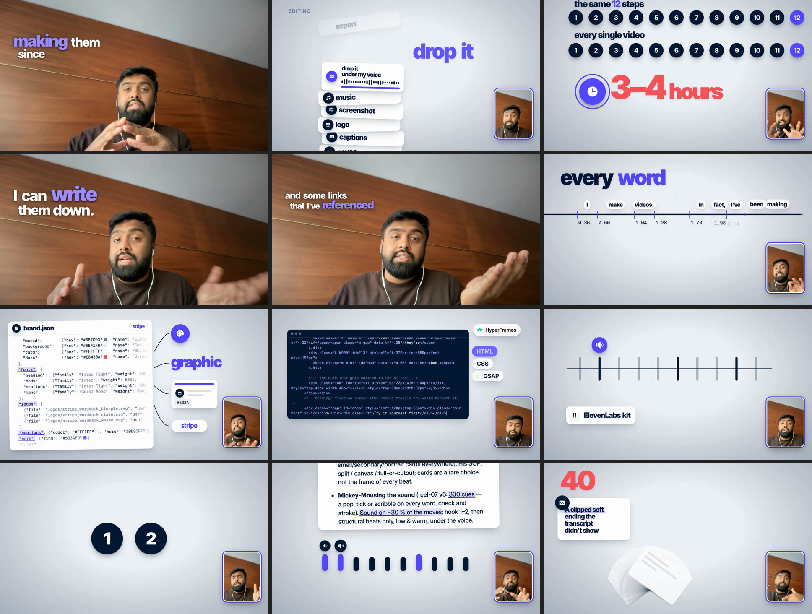

# stripe-video-skill

A Claude Code skill that edits a long-form talking-head recording into a finished, branded 16:9 YouTube video. The
default brand is Stripe. It cuts the take, plans the chapters and beats with you, builds the designed moments as
HyperFrames scenes in parallel, composites everything with ffmpeg, checks lip sync and loudness, and hands back
`final.mp4`, `captions.srt`, `chapters.txt`, a description and thumbnail stills.



## What's in here

```
skills/
├── stripe-youtube/   the skill: /stripe-youtube (SKILL.md, helpers, runtime, brand file, references, examples)
└── adnaan-reel/      the base pipeline it reuses: transcription, cutting, cut verification, captures, logo/photo/icon
                      fetchers, render + loudness, SFX kit, and the Python environment (pyproject.toml, uv.lock)
```

**The brand layer.** Every colour comes from one file, `skills/stripe-youtube/brand/stripe.json`:
- blurple `#533AFD` accent
- slate `#061B31` discs and ink
- cool paper `#EEF1F6`
- white cards
- strawberry for data only

At intake, `helpers/brand.py init` copies the file into the project. `board.py` and `talkcaps.py` then link the
generated `brand.css` into every scene, and the plates and inserts follow the same file. For another company, write a
brand file with the same keys and pass `--brand acme.json`.

## Install

Requirements: macOS or Linux, [Claude Code](https://claude.com/claude-code), [uv](https://docs.astral.sh/uv/), ffmpeg,
Node 22+ (for `npx hyperframes`), and Google Chrome (for page captures).

```bash
git clone https://github.com/adukhan98/stripe-video-skill.git
```

```bash
cp -R stripe-video-skill/skills/adnaan-reel stripe-video-skill/skills/stripe-youtube ~/.claude/skills/
```

```bash
uv sync --project ~/.claude/skills/adnaan-reel
```

The helpers expect the skills at exactly `~/.claude/skills/adnaan-reel` and `~/.claude/skills/stripe-youtube`.

Optional: the music bed and voice tools use ElevenLabs. Copy `skills/adnaan-reel/.env.example` to `.env` in that folder
and set `ELEVENLABS_API_KEY`.

## Use

In Claude Code, from the folder that holds your recording:

```
/stripe-youtube edit this video: <path to the camera file or Cap project>, script: …
```

It asks for two approvals, the chapter outline and then the beat table, before it builds anything. Say "just do it" to
skip them. Everything it writes goes into `./edit/`.

Run the tests with:

```bash
uv run --project ~/.claude/skills/adnaan-reel --group dev pytest -q ~/.claude/skills/stripe-youtube/tests
```

## Notes

- Stripe's logos are **not** in this repo. The brand file names the files it expects in `edit/logos/`; download the
  official ones from [Stripe's brand assets page](https://stripe.com/newsroom/brand-assets) for each project.
- Stripe's own typeface isn't public, so Inter Tight and Inter stand in.
- Icons are [Phosphor](https://phosphoricons.com) (MIT). Scenes render with [HyperFrames](https://github.com/heygen-com/hyperframes).
- This is an independent project. It is not made or endorsed by Stripe.

## License

MIT. See [LICENSE](LICENSE). `skills/adnaan-reel` keeps its own MIT license file.
